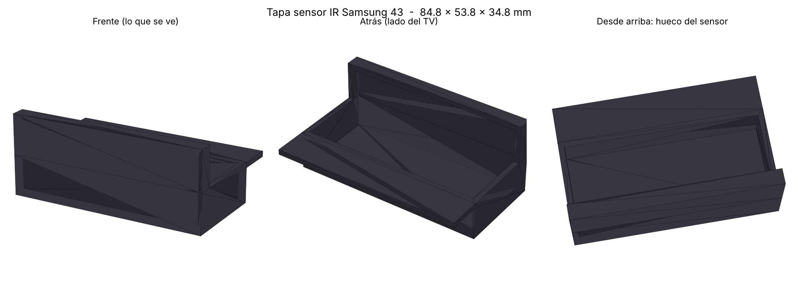
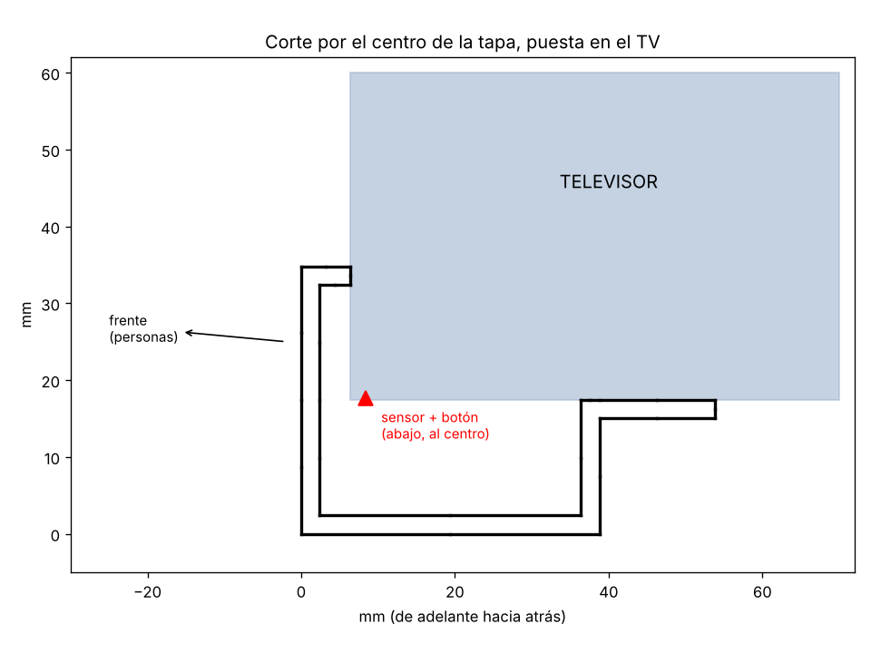

# Tapa para el sensor IR del televisor de la cartelera (Samsung 43")

Tapa para que los celulares con emisor infrarrojo no puedan apagar el televisor.

## Qué se sabe del televisor

- En los Samsung Crystal UHD (CU7000, DU7000 y parecidos), el manual pone el **sensor del control
  junto al botón del TV, en la parte de abajo del televisor**. Normalmente está en el centro.
- El cuerpo mide unos 60 mm de grosor sin la base (dato del UN43DU7000).
- No se encontró la medida exacta del módulo del botón. Por eso el hueco es amplio
  (80 × 34 × 15 mm) y tiene que caber de sobra.

## Antes de imprimir: verificar en el TV

1. Mire debajo del televisor, al centro: debe haber un botón pequeño con una lucecita.
2. Tápelo con el dedo y pruebe el control. Si deja de responder, ese es el sensor.
3. Mida el botón: si es más ancho que 80 mm o cuelga más de 15 mm, cambie `ancho` o
   `alto_modulo` en `tapa_sensor_ir.scad` (o en `generar_stl.py`).

## Archivos

- `tapa_sensor_ir.stl`: lista para imprimir (84.8 × 53.8 × 34.8 mm, unos 24 cm³ de plástico).
- `tapa_sensor_ir.scad`: la misma pieza en OpenSCAD, para cambiar medidas.
- `generar_stl.py`: crea el STL otra vez sin OpenSCAD.

## Cómo imprimirla

- PLA o PETG **negro**. Los colores claros dejan pasar algo de infrarrojo.
- 100 % de relleno, paredes de 2.4 mm.
- Acostada de lado (una de las caras laterales contra la cama). El techo del hueco queda
  como puente de unos 34 mm; si su impresora no hace bien los puentes, active soportes.
- Para estar seguros, forre el hueco por dentro con cinta de aluminio.

## Cómo instalarla

1. Limpie con alcohol la parte de abajo del TV y el borde del marco.
2. Ponga cinta 3M VHB en la pestaña de atrás, en los bordes de arriba de la bandeja y en el
   borde de arriba del frente.
3. Métala por debajo del TV, centrada sobre el botón, con el frente pegado al marco.
4. Pruebe con un celular con infrarrojo desde varios ángulos.

El control original y el botón del TV también quedan tapados. Para manejarlo hay que quitar la tapa.
